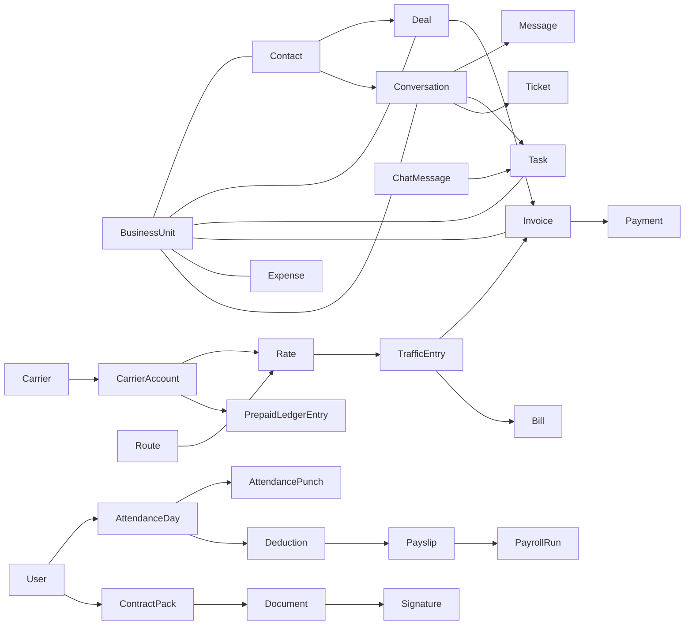

# Figuraid OS v2 — Architecture proposal (Step 1)

Status: **awaiting approval** · Source of truth: Figuraid OS v2 PRD (22 Oct 2026)

This document covers step 1 of the build order: architecture, folder structure and the complete data
model. No application code is written until this is approved. The Prisma schema in `prisma/schema/`
is complete for every module (A–R, privacy, security), validates, and has been migrated against
PostgreSQL 16 to prove it is sound.

---

## 1. Stack

| Layer | Choice | Why |
|---|---|---|
| Framework | **Next.js 15 (App Router), TypeScript `strict`** | Server Components keep data access on the server; Server Actions for mutations |
| Database | **PostgreSQL 16 + Prisma 6** (multi-file schema, one file per module) | Parameterised queries only (Security #5); migrations in git |
| Auth | **NextAuth v4** (stable), Credentials + TOTP 2FA, JWT carrying a server-side `sessionId` | Every request re-checks `UserSession` → remote sign-out, short lifetimes, step-up re-auth |
| Password hashing | argon2id + HaveIBeenPwned k-anonymity breached-password check | Security #1 |
| Styling | Tailwind CSS 3 + CSS-variable design tokens, Radix UI primitives, own component library | Light/dark mode from one token set; per-unit accent colours |
| Interaction | `cmdk` (Cmd+K), `@dnd-kit` (Kanban), Recharts (charts), `sonner` (toasts) | |
| Validation | Zod on every action input, webhook payload and form | |
| Jobs & schedules | **pg-boss** (Postgres-backed queue) in a separate worker process | SLA timers (every minute), sequences, reminders, CDR rating, digest, retention, backups — no Redis needed |
| Realtime | Server-Sent Events fed by Postgres `LISTEN/NOTIFY` | Inbox, chat, dashboard tiles and notifications update live |
| Files | S3-compatible private bucket (Cloudflare R2 recommended), signed expiring URLs, ClamAV scan before release | Security #11 |
| Email | Brevo (transactional + sequences + broadcasts) | Module D |
| AI | Model gateway with providers `gemini` (primary) and `groq` (fallback) behind one interface | Swappable without a rebuild (Module K) |
| PDF | `@react-pdf/renderer` for invoices, payslips, certificates, contract packs | |
| Tests | Vitest (unit + DB integration against a throwaway Postgres), Playwright (e2e + mobile viewports) | Access-control matrix, payroll and telecom billing tests are mandatory |
| CI | GitHub Actions: typecheck, lint, test, `npm audit`, Prisma migrate check, gitleaks; Dependabot | Security #4, #15 |

### Deployment (recommended: Node.js VPS, not Vercel)

`os.figuraid.com` → Cloudflare (WAF, rate limiting, Turnstile CAPTCHA) → Caddy/Nginx (TLS, HSTS) → two processes:

1. `web`: Next.js standalone server
2. `worker`: pg-boss job runner (same codebase, `npm run worker`)

with PostgreSQL (managed, encrypted at rest, point-in-time recovery) and an R2 bucket.

A VPS gives a **fixed egress IP** (WHMCS requires IP whitelisting), long-running workers for minute-level
SLA timers, ClamAV, and SSE without serverless timeouts. Vercel would also need an external cron,
queue and realtime provider. The code keeps this portable: jobs are plain functions, so they could run
on Vercel Cron + a hosted queue later.

---

## 2. Folder structure

```
figuraid-os/
├─ prisma/
│  ├─ schema/                 # one .prisma file per module + migrations/
│  └─ seed/                   # demo seed: every screen has realistic data
├─ src/
│  ├─ app/
│  │  ├─ (auth)/              # login, 2fa, reset, accept-invite, privacy acceptance
│  │  ├─ (app)/               # authenticated shell: sidebar, unit switcher, Cmd+K
│  │  │  ├─ page.tsx          # Command Centre (admin portal or staff "Today", by role)
│  │  │  ├─ work/             # tasks, targets, sops, reports, attendance, messages
│  │  │  ├─ customers/        # inbox, contacts, companies, pipelines, tickets, campaigns,
│  │  │  │                    # sequences, forms, referrals, tenders, academy
│  │  │  ├─ money/            # overview, invoices, payments, expenses, bills, subscriptions,
│  │  │  │                    # procurement, domains, cashflow, telecom/*
│  │  │  ├─ team/             # staff, onboarding, payroll, leave, contracts, documents, exits
│  │  │  └─ settings/         # roles & permissions, units, offices, routing, integrations,
│  │  │                       # policies, retention, audit log, security
│  │  ├─ (public)/            # privacy notices, /verify/[code], /f/[slug] forms,
│  │  │                       # /sign/[token], /csat/[token], /r/[code], /unsubscribe
│  │  └─ api/
│  │     ├─ webhooks/{paystack,whmcs,meta,brevo}/route.ts   # signature-verified
│  │     ├─ widget/           # website live-chat endpoints (rate limited, Turnstile)
│  │     ├─ events/           # SSE stream
│  │     └─ files/            # signed upload/download
│  ├─ server/                 # server-only code (import "server-only")
│  │  ├─ db.ts                # Prisma client — importable ONLY from server/modules/** (lint rule)
│  │  ├─ auth/                # NextAuth config, sessions, 2FA, lockout, step-up
│  │  ├─ authz/               # permission catalog, policy engine, scope → Prisma where, field masks
│  │  ├─ audit/               # hash-chained audit writer
│  │  ├─ crypto/              # AES-256-GCM field encryption, key rotation
│  │  ├─ files/               # storage, signed URLs, scanning
│  │  ├─ jobs/                # pg-boss definitions + schedules
│  │  ├─ realtime/            # LISTEN/NOTIFY → SSE fan-out
│  │  ├─ ai/                  # gateway, providers/{gemini,groq}, redaction, knowledge-only context
│  │  ├─ integrations/        # paystack, whmcs, brevo, meta, linkedin, imap, sms
│  │  └─ modules/<module>/    # service.ts · queries.ts · actions.ts · schemas.ts
│  ├─ domain/                 # pure, framework-free business logic (100% unit tested)
│  │  ├─ telecom/             # increments, rating, cycles 7/3 & 7/4, margins, netting
│  │  ├─ payroll/             # lateness tiers, absence daily-rate, caps, net pay
│  │  ├─ attendance/          # geofence (haversine), lateness, flags
│  │  ├─ finance/             # VAT, FX, ageing, cash-flow projection
│  │  └─ crm/                 # lead scoring, duplicate matching, fractional ranks
│  ├─ ui/                     # design system: tokens, primitives, patterns, charts, icons
│  └─ lib/                    # shared client-safe utilities (formatting, dates)
├─ worker/                    # worker entrypoint
├─ tests/{unit,integration,e2e}
└─ docs/                      # this file, security checklist, runbooks, incident response
```

**The single rule that keeps access control honest:** pages and components never touch Prisma. Every
read and write goes through `server/modules/*`, and every exported function there is wrapped by:

```ts
export const listDeals = query({
  permission: ["crm.deals", "VIEW"],
  input: ListDealsInput,                         // zod
  handler: async ({ ctx, input, scope }) =>
    db.deal.findMany({ where: { AND: [scope, filters(input)] } }),
});
```

`query`/`action` resolve the session (rejecting revoked sessions, expired auditors and unsigned
contract packs), check the permission, deny by default, build the scope (`ALL` → `{}`, `UNIT` →
`{ unitId: { in: ctx.unitIds } }`, `OWN` → `{ ownerId: ctx.userId }`), apply field masks (buy rates,
margins, salaries, bank details) and write the audit entry for sensitive actions. Fetching by id always
goes through the same scope, so a guessed or copied id returns 404 (Security #2, #3).

---

## 3. Data model — 126 models across 16 files

| File | Module(s) | Key models |
|---|---|---|
| `core` | Identity, RBAC, audit, platform | BusinessUnit, User, UserUnit, Role, RolePermission, UserGrant, UserSession, RecoveryCode, LoginAttempt, Device, AuditLog, Notification, PushSubscription, Setting, FileObject, IntegrationConnection, WebhookEvent, ExchangeRate |
| `crm` | C | Company, Contact, Tag, Pipeline, PipelineStage, Deal, LostReason, Activity (timeline), LeadForm, FormSubmission |
| `email` | D | EmailSequence, SequenceStep, SequenceEnrollment, Broadcast, EmailMessage, Suppression, Consent |
| `inbox` | B, K | InboxChannel, Conversation, Message, ConversationNote, ConversationAssignment, SavedReply, WhatsAppTemplate, RoutingRule(+Member), KnowledgeArticle, AiInteraction, AiQueueItem, AiQuotaUsage |
| `telecom` | E | Carrier, CarrierAccount (terms per side), Route, Rate (history), RateDeck, TrafficEntry, CdrImport, PrepaidLedgerEntry, Dispute |
| `finance` | F, M | BankAccount, BankBalanceSnapshot, Payment, ExpenseCategory, Expense, Invoice(+Line), Bill, RecurringItem, Subscription, Supplier, ResaleItem, Domain, SupplierPrice |
| `work` | G | Project, Task, TaskComment, TaskChecklistItem, TaskAttachment, Sop, SopStep, WeeklyTarget, DailyReport, FocusSession |
| `attendance` | H | Office, AttendanceDay, AttendancePunch, LeaveRequest, PublicHoliday, AttendanceExcuse |
| `hr` | L | StaffProfile, LatenessPolicy, Deduction, PayrollRun, Payslip, ContractTemplate, ContractPack, ExitCase |
| `vault` | O | Document, Signature, DocumentAccessLog |
| `academy` | Academy, N | Course, Cohort, CourseEnrollment, Certificate |
| `growth` | P, Q, J | Tender, TenderChecklistItem, Referrer, CommissionRule, Referral, ReferralPayout, AdCampaign, Ad, AdInsightDaily, UtmLink, SocialPost |
| `support` | I | Ticket, TicketComment |
| `messaging` | R | ChatChannel, ChatMember, ChatMessage, ChatMention, Announcement, AnnouncementAck |
| `privacy` | Privacy | PolicyDocument, PolicyAcceptance, DataSubjectRequest, RetentionRule |



### Modelling decisions worth your review

1. **Business units are a table** (`BusinessUnit` with a `UnitCode` enum key) rather than a bare enum, so
   accent colour, timezone and future units are data, not code. Every business record has `unitId`
   plus an owner (`ownerId` / `assigneeId` / `recordedById`).
2. **Contact + Deal instead of a separate Lead table.** A "lead" is a contact at `lifecycle = LEAD`
   with an open deal in its unit's pipeline. Inbox, forms, referrals and the AI all create both, which
   keeps one timeline per person and avoids lead→contact conversion bugs.
3. **Telecom terms live on `CarrierAccount`, one per side.** A carrier flagged BOTH has a vendor account
   and a customer account, each with its own cycle (7/3, 7/4), increment (60/60, 30/30, 1/1), currency,
   prepaid/postpaid mode, credit limit and balance. Netting is a flag on the carrier.
4. **Rates are append-only history.** A database trigger blocks editing or deleting a rate. A new
   price is a new row with a new `effectiveFrom`. Each `TrafficEntry` stores the exact buy and sell
   `Rate` rows used, the billed minutes after each side's increment, and the cost and revenue, so
   invoices are reproducible and margin is always `revenue − cost`.
5. **Permissions are data, the catalogue is code.** `RolePermission(module, action, scope)` rows per
   role, plus `UserGrant` for individual and temporary grants. The list of modules, actions and
   sensitive flags is a typed catalogue in `server/authz/catalog.ts` (§4), so the app can't reference
   a permission that doesn't exist.
6. **Field-level encryption** (`…Enc` columns, AES-256-GCM, versioned keys) for salaries, allowances,
   bank details, ID numbers, payslip figures, final pay, TOTP secrets and third-party tokens. Payroll
   totals are computed in the app after decryption, never by SQL.
7. **AuditLog is append-only, enforced in Postgres** (trigger rejects UPDATE/DELETE/TRUNCATE) and
   hash-chained (`prevHash` → `hash`) so tampering is detectable even by someone with DB access.
8. **The AI can only read `KnowledgeArticle`.** The AI module gets no Prisma access beyond that table.
   Its context builder is the only path to the model, and it masks phones and emails first. Every
   call is logged in `AiInteraction`. Quota is tracked per Pacific-time day in `AiQuotaUsage`, and
   overflow goes to `AiQueueItem` with a staff alert.
9. **Attendance keeps raw punches and derives days from them.** `AttendancePunch` records GPS,
   accuracy, distance, IP, device, selfie hash, offline flag and a list of `flags`. A suspicious punch
   is saved with `reviewStatus = PENDING`, never rejected. `AttendanceDay` is computed from punches,
   schedule, leave and holidays, and is locked when payroll closes.
10. **Signed documents are frozen.** Contract-pack documents store the merged text plus a SHA-256
    `contentHash`. Each `Signature` records IP, user agent, time and the hash it signed. Editing a
    template creates a new version and never changes a signed document.
11. **The database enforces some rules too** (migration `integrity_guards`): one approved device per
    user, FX rate required on non-NGN money, a conversation can't be RESOLVED without a reply or a
    resolution note, valid CSAT, probability and geofence ranges.

---

## 4. Permission catalogue and default roles

Actions: `VIEW · CREATE · EDIT · DELETE · APPROVE · EXPORT`. Scopes: `OWN · UNIT · ALL`.
⚠ = sensitive: only Super Admin can grant it, and every grant is audited.

Modules: `dashboard.admin`, `dashboard.today`, `inbox`, `crm.contacts`, `crm.deals`, `crm.pipelines`,
`crm.forms`, `email.sequences`, `email.broadcasts`, `marketing.campaigns`, `marketing.ad_spend`,
`tasks`, `targets`, `sops`, `reports.daily`, `messaging`, `announcements`, `attendance`,
`attendance.review`, `leave`, `support.tickets`, `academy`, `academy.certificates`, `finance.income`,
`finance.expenses`, `finance.invoices`, `finance.bills`, `finance.reports`, `finance.cashflow`,
`subscriptions`, `procurement`, `telecom.carriers`, `telecom.routes`, `telecom.traffic`,
`telecom.sell_rates`, `telecom.buy_rates`⚠, `telecom.margins`⚠, `telecom.billing`, `telecom.disputes`,
`telecom.prepaid`, `hr.staff`, `hr.onboarding`, `hr.contracts`, `hr.deductions`, `hr.salaries`⚠,
`hr.bank_details`⚠, `payroll`⚠, `payroll.signoff`⚠, `documents`, `tenders`, `referrals`,
`referrals.payouts`, `privacy.dsr`, `settings`, `settings.billing`⚠, `roles`⚠, `audit`⚠, `exports`⚠.

| Role | Summary of default grants |
|---|---|
| Super Admin | Everything, ALL scope |
| Admin | Everything except `roles`, `settings.billing`, `payroll.signoff` |
| Operations Manager | ALL scope on tasks, targets, pipelines, inbox, attendance(+review), tickets, staff performance, admin dashboard (revenue). No payroll, salaries, bank details or settings. Margins only with a grant |
| Finance | ALL scope on finance.\*, telecom billing, prepaid, buy rates, margins, subscriptions, procurement, cash flow, payroll processing. Payroll above the limit needs Super Admin `payroll.signoff`. No CRM, inbox or settings |
| HR | hr.staff, onboarding, contracts, attendance review, leave, deductions, exits. No salaries or bank details |
| Manager (unit) | UNIT scope: contacts, deals, pipelines, tasks, targets, attendance, unit finance summary |
| Marketing | Campaigns, ad spend, sequences, broadcasts, forms, lead sources. No other finance |
| Telecom Operations | Carriers, routes, sell rates, traffic, CDR, disputes, prepaid balances. No buy rates or margins |
| Academy Coordinator | Academy (students, cohorts, scholarships, certificates) |
| Staff | OWN scope: tasks, assigned contacts, deals and conversations, attendance, targets, deductions, payslips |
| Support Agent | Inbox and tickets only |
| Auditor | VIEW on finance.\* and audit, with `accessExpiresAt`. Exporting needs an approval |

A note on the PRD: it says both "Finance… visible to Admins and Managers only" and gives the Finance
role full finance access. I've read the role table as authoritative: Finance and Admin see all finance;
unit Managers see only their unit's finance summary.

---

## 5. Security controls → where they live

| # | Control | Implementation |
|---|---|---|
| 1 | Account takeover | argon2id; zxcvbn ≥3 + HIBP check; 5 failures → 15-min lockout (`LoginAttempt`, `lockedUntil`); TOTP mandatory where `Role.requires2fa`; recovery codes; new-device login alert |
| 2 | Broken access control | `query`/`action` wrappers, deny by default, scoped `where`; generated test matrix role × module × action |
| 3 | IDOR | cuid ids everywhere; fetch-by-id goes through scope; invoice/ticket numbers are display-only |
| 4 | Secrets | `.env` gitignored, `.env.example` committed; gitleaks in CI; GitHub secret scanning; separate dev/prod keys |
| 5 | Injection/XSS | Prisma only (raw SQL banned by lint except migrations); inbound text stored as plain text and rendered escaped; email HTML sanitised (DOMPurify) and shown in a sandboxed iframe; strict nonce-based CSP |
| 6 | Webhook spoofing | HMAC verification (Paystack SHA-512, Meta `X-Hub-Signature-256`, Brevo token, WHMCS shared secret + IP allow-list); `WebhookEvent (provider,eventId)` unique → replay rejected; payments start `PENDING_RECONCILIATION` until verified via the provider API |
| 7 | Prompt injection | AI reads only `KnowledgeArticle`; no tools that write money, rates or deletes; outputs filtered for internal terms; handoff on approval-required topics; full logging |
| 8 | Attendance fraud | Device binding (one approved device, unique index), selfie hash re-use detection, accuracy and mock-location flags, clock-skew check, review queue, random spot checks |
| 9 | Insider theft | `exports` permission (⚠); every export audited and watermarked with user and time; bulk-view alert job; exit flow revokes sessions and grants immediately |
| 10 | Session hijacking | `__Host-` Secure HttpOnly SameSite=Lax cookies; 8h absolute and 30-min idle; step-up re-auth (`reauthAt`) for finance/payroll; "sign out everywhere"; Server Action origin check + CSRF token on route handlers |
| 11 | Uploads | MIME sniffing + extension allow-list + size caps per purpose; ClamAV; private bucket; signed URLs ≤5 min |
| 12 | Backups | Managed PITR + nightly encrypted `pg_dump` to a separate R2 bucket, 30-day retention; monthly restore test job and runbook |
| 13 | Transit/at rest | HTTPS + HSTS preload; DB encryption at rest; field-level AES-256-GCM with key versioning |
| 14 | Audit trail | Append-only trigger + hash chain; Super Admin only |
| 15 | Dependencies | Dependabot, `npm audit --audit-level=high` in CI |
| 16 | DoS/abuse | Cloudflare WAF and rate limits; in-app token bucket per IP and per user; Turnstile on public forms and chat |
| 17 | Third-party tokens | Encrypted `IntegrationConnection`, least-privilege scopes, `rotatedAt`, `lastUsedAt` monitoring |
| 18 | Headers/config | CSP, `X-Frame-Options: DENY`, `Referrer-Policy: strict-origin-when-cross-origin`, `Permissions-Policy` (camera and geolocation self-only), `poweredByHeader: false`, no stack traces in production |

---

## 6. Design system direction (built in step 2)

- **Identity:** Figuraid signature accent (proposed deep indigo `#4F46E5` family, to confirm against
  your brand assets), neutral zinc greys, Inter for UI, JetBrains Mono for figures and codes, tabular
  numerals for all money.
- **Unit accents:** Academy violet, FigureWeb sky blue, Telecom amber, HQ slate. Used as a 2px rail,
  badges and chart series, never as large fills.
- **Shell:** collapsible left sidebar grouped *Work · Customers · Money · Team* (+ Settings), unit
  switcher pinned at the top (All · Academy · FigureWeb · Telecom), Cmd+K palette to jump anywhere or
  create anything, notifications bell, clock-in pill always visible on mobile.
- **Components:** Button, Input, Select, Combobox, DatePicker, Dialog, Sheet, Tabs, Table (sortable,
  inline edit), Kanban, StatCard with trend, Chart wrappers, EmptyState with next-step guidance,
  Skeletons, Toasts. One spacing scale (4px base), 8px radius, subtle 150–200ms motion.

---

## 7. Decisions I need from you

1. **Hosting:** Node.js VPS (recommended, for the fixed IP WHMCS needs, background workers and
   realtime) or Vercel? If VPS, which provider/region? AWS af-south-1 and Hetzner are typical choices.
2. **File storage:** Cloudflare R2 (recommended, and pairs with Cloudflare in front) or AWS S3?
3. **Sign-in:** email + password + TOTP only, or also "Sign in with Google" if staff have
   Google Workspace accounts on figuraid.com?
4. **Office geofence:** the exact coordinates of the Abuja office (and any other sites), and whether
   any staff are allowed remote clock-in.
5. **Brand:** logo files and the official Figuraid accent colour, if one exists. Otherwise I'll
   propose one in step 2.
6. **Reporting currency:** NGN for all dashboards with USD telecom converted at the transaction's FX
   rate (my assumption)? And who maintains daily FX rates: manual entry or an FX API?
7. **Payroll sign-off limit:** the naira amount above which Super Admin must sign off.
8. **Groq fallback:** your build brief adds Groq as an AI fallback, which the PRD doesn't mention. The
   same masking and public-only rules will apply to it. Please confirm you're comfortable with Groq's
   data terms.
9. **Data-subject request deadline:** I've defaulted to 30 days, configurable. Please confirm the
   window with your lawyer or DPO under NDPA 2023 and the NDPC guidance.
